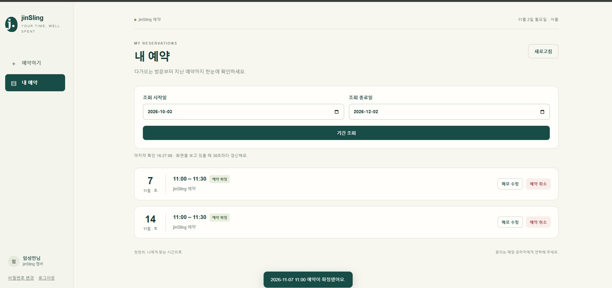
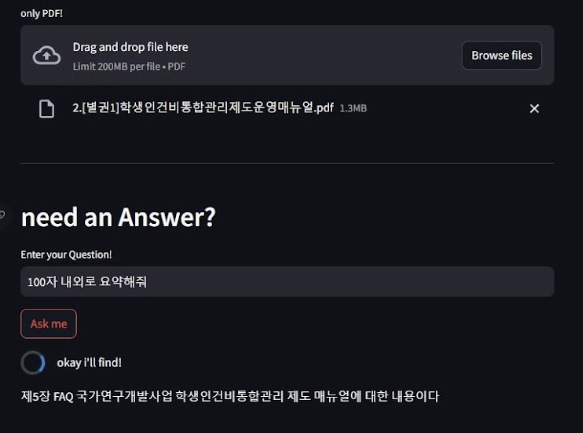

# 임성민 | AI Product Builder

**[포트폴리오 웹사이트 보기](https://limsweb.github.io/)**

## 기획서 다음 장은, 실행 화면입니다.

사업기획·PM 경험을 바탕으로 AI 연구와 서비스 구현을 이끕니다. 문제를 정리하고, 필요한 기술을 연결하고, 써보며 고칩니다.

[이력서](RESUME.md) · [PDF](Resume_Lim_Seongmin.pdf) · [GitHub 프로필](https://github.com/LimsWeb)

## 프로젝트

| 프로젝트 | 한 줄 소개 | 상태 |
|---|---|---|
| [AI 스피칭 트레이너](project-notes/speech-ai.md) | 발표자료·음성·자세를 함께 읽고, 근거가 있는 발표 코칭을 만드는 로컬 AI 연구입니다. | 논문 · 연구 |
| [JIN슬링](project-notes/jinsling.md) | 1인 매장의 가입·예약·운영 규칙을 하나의 웹서비스로 연결했습니다. | 배포 · 시험 운영 |
| [오성순](project-notes/oseongsun.md) | 대화와 작업의 맥락을 이어가기 위해 직접 사용하며 다듬는 개인용 로컬 AI 비서입니다. | 개인 사용 · 개선 |
| [초임계 추출 예측](project-notes/process-ml.md) | 공정 최적화라는 현장 목적을 데이터 정제와 추출 결과 예측 모델로 구체화했습니다. | 모델 학습 |
| [데이터관리 Tool](project-notes/data-tool.md) | 파일 업로드에서 데이터 파악, 분석 결과 확인과 질문까지 이어지는 업무 도구를 기획했습니다. | 기획 · 리드 |
| [회의록 summary](project-notes/meeting-summary.md) | 회의 음성의 입력부터 처리 상태 확인과 기록 조회까지, 회의 정리 흐름을 구현했습니다. | 프로토타입 |
| [YOLO · Vision](project-notes/vision.md) | 균열과 음식 객체 검출을 경험하고, 발표자 자세 분석으로 시각 데이터의 활용 범위를 넓혔습니다. | 모델 학습 · 응용 |
| [PDF봇 · 문서 도구](project-notes/pdf-tools.md) | PDF에 질문하는 챗봇과 OCR을 통해 문서 속 정보를 꺼내 쓰는 인터페이스를 구현했습니다. | 문서 AI 구현 |

## 실제 작업 화면

[YOLO · Vision 개발 기록 보기 →](project-notes/vision.md)

## 연락처

smlim1220@gmail.com

---

웹사이트 게시 설정은 [SETUP.md](SETUP.md)를 참고하세요.
