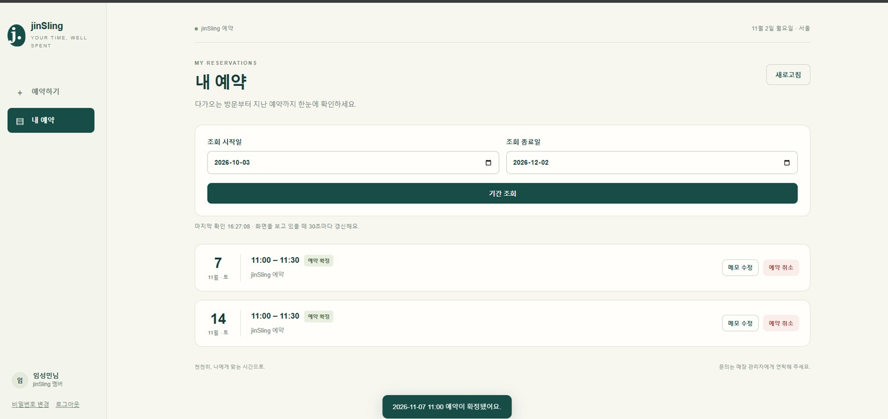

# JIN슬링

**1인 매장의 가입·예약·운영 규칙을 하나의 웹서비스로 연결했습니다.**

- 상태: 개발·배포 · 시험 운영 중
- 역할: 서비스 기획 · AI 협업 개발·배포 · 가이드 작성
- 활용: 웹서비스, Cloudflare, 데이터베이스, QR, ChatGPT·Codex

## 사장님과 고객이 같은 예약을 보도록

1인 매장은 고객 응대와 예약 확인, 변경, 휴무 반영을 함께 처리해야 합니다. 이용자는 QR로 접속하고 운영자는 회원과 예약을 관리하는 웹서비스를 기획했습니다.

## 요구사항에서 배포와 안내까지

가입·관리자 승인, 예약 등록·조회·변경·취소 흐름과 우선순위를 정했습니다. ChatGPT·Codex와 개발·배포를 진행하고 시험 중 발견한 동작 차이와 변경 요청을 구체화했습니다.

회원용·운영자용 이용 가이드와 QR 안내물을 만들었습니다. 영업시간, 휴무, 점심시간과 반복 차단 등 매장 운영 상황도 규칙으로 정리했습니다.

## 배포 이후 확인하는 문제

Cloudflare 기반으로 배포하고 예약 확정·조회 흐름을 시험했습니다. 현재는 예약 내역과 관리자·캘린더 표시의 일치, 중복 예약 방지, 로그인·승인과 반복 차단의 예외를 점검하며 개선하고 있습니다.

가이드에 담긴 예정 기능과 실제 배포 기능을 맞추고, 반복 사용과 운영 기록을 축적하는 단계입니다.

## 다음 기능은 AI 예약·관리

자연어 일정·회원 관리와 대화형 예약은 후속 계획입니다. 기존 예약 흐름의 안정성을 확인한 뒤 적용 범위를 정하려 합니다.

## 링크

- [GitHub 저장소](https://github.com/LimsWeb/JINSling)

