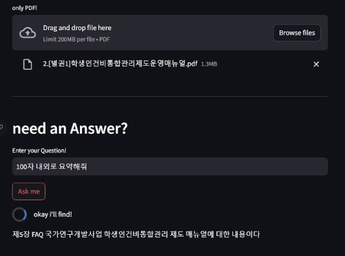

# PDF봇 · 문서 도구

**PDF에 질문하는 챗봇과 OCR을 통해 문서 속 정보를 꺼내 쓰는 인터페이스를 구현했습니다.**

- 상태: 구현·활용 경험
- 역할: 문서 처리·챗봇 프로토타입 구현
- 활용: Python, Tesseract, ChatGPT, Llama, PDF

## 문서를 질문의 대상으로

PDF 문서를 대상으로 질문하는 PDF Chat과 ChatGPT·Llama 계열 모델 기반 챗봇 프로토타입을 구현했습니다. 문서에서 필요한 정보를 확인하는 인터페이스와 언어모델 응용을 경험했습니다.

## 문서와 이미지에서 텍스트 확보

Tesseract OCR을 연동해 문서·이미지의 텍스트와 데이터를 추출하는 작업을 수행했습니다. 이 경험은 스피칭 트레이너의 PaddleOCR 기반 발표자료 분석으로도 이어졌습니다.

