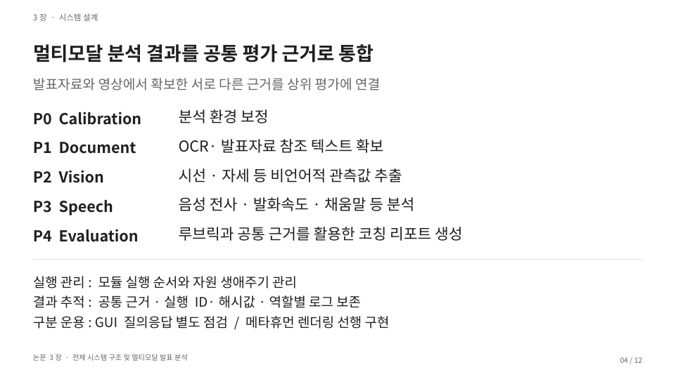

# AI 스피칭 트레이너

**발표자료·음성·자세를 함께 읽고, 근거가 있는 발표 코칭을 만드는 로컬 AI 연구입니다.**

- 상태: 연구·프로토타입 · 학위논문 작성 중
- 역할: 연구 기획 · 실험 설계 · AI 협업 개발
- 활용: Python, PyTorch, PaddleOCR, Whisper, YOLOv8 Pose, MediaPipe, 로컬 LLM

## 발표의 내용과 전달을 함께 보기

발표자료의 내용, 실제 발화, 시선과 자세를 함께 살펴보고 유지할 행동과 개선할 행동을 설명하는 코칭 시스템을 연구했습니다.

제한된 단일 GPU에서 분석과 평가를 반복 실행할 수 있는지, 루브릭 검색·역할별 평가·근거 검증을 결합한 구조가 단일 종합평가와 어떤 차이를 보이는지 검토했습니다.

## 내가 정하고 연결한 것

연구 주제와 가설, 분석 항목, 모듈 통합 구조, 비교 조건과 결과 해석을 주도하고 논문 원고와 발표자료로 정리했습니다. 코드 작성과 오류 수정에는 ChatGPT·Codex를 활용하며 변경 방향을 조율했습니다.

자료 텍스트 확보 → 자세·얼굴 관측 → 발화 전사 → 근거 기반 리포트로 이어지는 구조입니다. 같은 로컬 LLM을 강점·개선·종합 역할로 호출하고, 인용 문장과 수치가 입력 근거에 있는지 검사합니다.

## 80회 실행으로 확인한 범위

본실험은 4개 발표 사례 × 2개 조건 × 각 10회로, 총 80회 실행·80회 완료, 40개 대응 쌍입니다. 같은 네 사례를 반복한 실험이며 참여자 80명을 평가한 결과가 아닙니다.

RTX 4060 Ti 16GB 환경에서 GPU 메모리 부족으로 중단된 실행은 0회였습니다. 약 1초 간격으로 관측한 장치 전체 VRAM 최고값은 7.961 GiB였습니다. 이 결과는 명시한 입력과 환경에서의 실행 가능성을 보여줍니다.

## 연구의 현재 위치

전남대학교 대학원 지능정보융합학과에서 「자원 제약 환경에서의 멀티모달 발표 분석과 루브릭 기반 다중 역할 평가」 석사학위논문을 연구·작성 중입니다. 기준 자료는 2026.11.05 원고와 2026.11.06 발표자료입니다.

실제 사용자의 발표능력 향상은 후속 검증 과제입니다. 새로운 발표 사례, 독립 평가자, 사용자 효과와 각 평가 구성요소의 기여를 확인하려 합니다.

