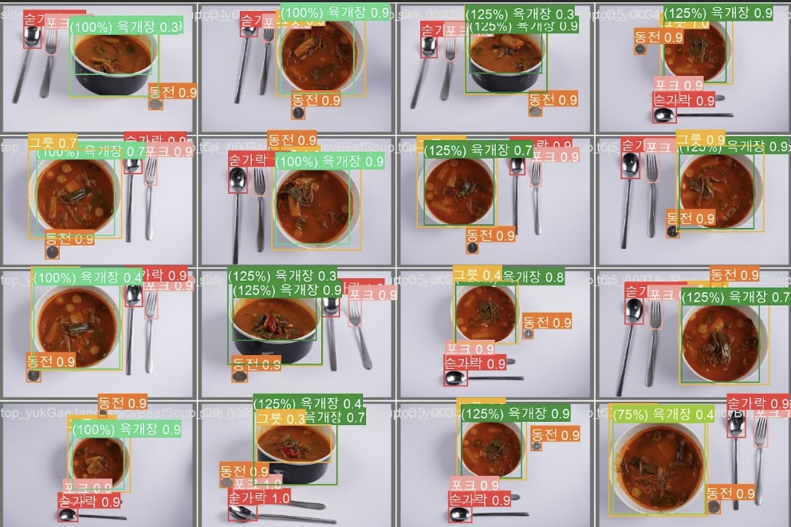

# YOLO · Vision

**균열과 음식 객체 검출을 경험하고, 발표자 자세 분석으로 시각 데이터의 활용 범위를 넓혔습니다.**

- 상태: 과거 수행·학습 경험
- 역할: Python·Vision 개발 · 객체 검출 모델 학습
- 활용: Python, YOLOv5, YOLOv8 Pose, 전이학습

## 이미지에서 필요한 대상을 찾기

Python·Vision 개발 업무에서 YOLO 기반 객체 검출과 학습을 경험했습니다. 과거 이력서에는 YOLOv5 균열 검출 학습, 한국 음식 객체 검출·양 추정과 전이학습 수행 내용이 있습니다.

## 다른 문제로 이어진 시각 분석

최근 AI 스피칭 트레이너 연구에서는 YOLOv8 Pose를 발표자의 자세 관측에 활용했습니다. 시각 분석 결과를 음성과 자료의 근거와 함께 다루는 경험으로 연결했습니다.

